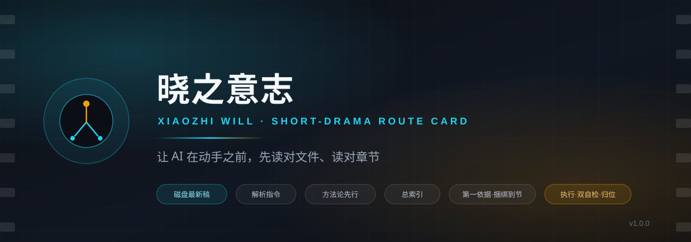
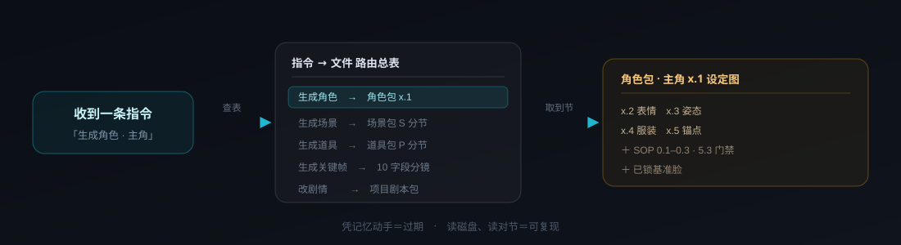

<div align="center">



# 🧭 晓之意志 · AI 短剧指令路由卡

**v1.0.0** · Xiaozhi Will · Short-Drama Route Card

> 一条「指令 → 文件」的存取约定。
> 不生产内容，只负责让 AI 在动手之前，读对文件、读对章节。


[这是什么](#什么是晓之意志) · [为什么需要它](#为什么需要它) · [工作方式](#工作方式) · [快速开始](#快速开始) · [目录结构](#目录结构) · [赞助](#赞助与合作) · [更新记录](#更新记录)

</div>

---

## 什么是晓之意志

一份**给 AI 助手执行的短剧 / 漫剧制作路由卡**。

它本身不做创作。它是一张表，回答一个问题：

> **收到这条指令，我该去读哪个文件的哪一节？**

答案写死在卡上，不依赖 AI 的记忆，也不依赖你每次重新交代项目结构。

<div align="center">

</div>

---

## 为什么需要它

带 AI 做过短剧的人，大概率都踩过这三个坑。

**一、AI 不记得该读什么。**
每次开工都要重新交代：资产包在哪、SOP 在哪、机位图叫什么、分镜表是第几版。这次交代完，下次换个会话又得重来。

**二、两个文件冲突时，不知道该听谁。**
总索引参数卡写 16:9，外部 skill 默认 9:16，那你到底按哪个做？没有仲裁规则，AI 就会自己挑一个。

**三、改了一处，下游全崩。**
改了剧本台词，忘了回头同步分镜；改了分镜机位，忘了同步机位图。等到出图才发现全对不上。

晓之意志用三样东西回答这三个问题：**一张路由表**、**一套仲裁优先级**、**一张改动联动表**。

---

## 工作方式

### 六步固定响应流程

每条制作指令进来，都按同一个顺序走：

| 步 | 动作 | 关键点 |
|:---:|:---|:---|
| **0** | 读磁盘最新稿 | 磁盘当前文件为准，对话记忆一律视为过期 |
| **1** | 解析指令 | 动作 ＋ 对象 ＋ 产物类型 |
| **2** | 方法论先行 | 按产物类型，先读 `references/` 里命中的那一节 |
| **3** | 读项目总索引 | 参数卡、最新状态、双编号、定稿门禁 |
| **4** | 第一依据 ＋ 捆绑取齐到节 | 路由表第一依据、SOP、固定前缀逐字复制 |
| **5** | 执行 · 双自检 · 归位 | SOP 核验 ＋ 方法论自检 ＋ 下游联动 ＋ 报你确认 |

> 顺序原则：**先图纸，后盖楼。** 方法论先于项目文件读取——先知道该怎么做，再去看这次要做什么。

### 指令 → 文件 路由总表

| 你要做的事 | 第一依据 | 必读捆绑 | 产出归位 |
|:---|:---|:---|:---|
| 生成**角色** | 角色包 · 该角色 x.1 | SOP；0.1–0.3 基底与负向；5.3 门禁；x.2–x.5 | `资产图片音频汇总/角色设定图/{角色}/` |
| 生成**场景** | 场景包 · 该 S 分节 | 六视图 / 光影 / 空间锚点；机位图轴线 | `资产图片音频汇总/场景设计图/` |
| 生成**道具** | 道具包 · 该 P 分节 | 六视图 / 材质 / 陈设；场景承托面 | `资产图片音频汇总/道具设计图/{道具}/` |
| 生成**关键帧** | 10 字段分镜 · 该镜 | 分镜第四章连续性锚点；关键帧公式；机位图站位 | `资产图片音频汇总/关键帧/` |
| 生成**视频片段** | 10 字段分镜 · 逐镜 | SOP 三；剪辑包闸门；P4 投喂六步 | `资产图片音频汇总/视频片段/` |
| 改剧情 / 台词 / 人设 | 项目剧本包 | 本集剧本分场；剧情源原文 | 更新 `.md`，重生成 docx |
| 切镜头 / 改机位 | 10 字段分镜 | 模板库 7.2–7.4；6.4 轴线 | 同步机位图 |
| 剪辑 / 转场 / 配乐 | 剪辑资产包 | 剪辑包 7 九步 SOP；10 质检 | 母版出 16:9 |
| 查原著依据 | 剧情源查章路由 | 剧情源结构地图 | — |

### 冲突仲裁优先级

两个文件打架时，按这个顺序判：

| 序 | 规则 |
|:---:|:---|
| ⓪ | 磁盘当前 `.md` ＞ 对话记忆 / 摘要 |
| ① | `.md` ＞ `.docx` |
| ② | 10 字段分镜 ＞ 基础分镜 |
| ③ | 资产包原文 ＋ 参数卡 ＞ SOP / 路由卡 |
| ④ | 双编号查总索引映射表 |
| ⑤ | 最新拍板日期优先 |
| ⑥ | 门禁不跳级；剧情对原著不增、不改、不删 |
| ⑦ | **本剧 `.md` ＞ 外部 skill 方法论**（只补方法，不覆盖参数） |
| ⑧ | 剧情源原文 ＞ 总纲 ＞ 分集大纲 / 剧本 / 分镜 |

### 三条总纪律

| | 纪律 | 含义 |
|:---:|:---|:---|
| ⓪ | 磁盘当前 `.md` ＞ 一切记忆 | 动手前必须读磁盘，不许凭印象 |
| ⑦ | 本剧 `.md` ＞ 外部 skill | 外部默认值（9:16 / R2 高燃 / 21:9）不得覆盖你锁定的值 |
| ⑧ | 剧情源 ＞ 总纲 ＞ 分集 | 剧情唯一来源是你的剧情源 |

---

## 核心能力

| 模块 | 它解决什么 |
|:---|:---|
| 📇 **路由总表** | 10 类指令各自的第一依据、必读捆绑（精确到节）、产出归位 |
| 🎥 **机位图四类必读时机** | 哪四种情况必须读机位图，哪两种可以跳过 |
| 🖼️ **关键帧跨三包取件清单** | 分镜连续性锚点 ＋ 三包各自公式，一张清单取齐，不易漏 |
| 🔗 **改动联动表** | 上游一改，下游必须同步谁，逐条列出 |
| ⚖️ **冲突仲裁 ⑧ 条** | 文件打架时有据可依 |
| ✅ **交付前自检清单** | 逐项打勾，含「未用 skill 默认值覆盖本剧锁定值」这类高频翻车点 |
| 🎬 **诺兰电影化手法基石** | 非线性、闪回、交叉蒙太奇、片尾双钩——P0 立项级必读 |
| 📚 **A/B/C 三库路由** | A 库定流程门、B 库定提示词写法、C 库定工程组织 |
| 🚀 **Seedance 2.5 / SeedAudio 1.0** | 七条铁律、三层解耦、T2A/A2A 投喂模板 |
| 📜 **剧情三不铁律 ＋ 改编白名单** | 有判定标准与统一边界 |

---

## 适用场景

- AI 短剧 / 漫剧 / 短视频剧集的日常生产
- 需要出角色图 / 场景图 / 道具图，且要求跨镜跨集形象一致
- 需要按 10 字段分镜表出关键帧与 Seedance 视频片段
- 需要边写边核对原著（不添加 / 不更改 / 不删除）
- 多人、或多个 AI 交替接手同一个项目

---

## 快速开始

### 1. 安装

把 `xiaozhi-will` 整个文件夹复制到技能目录：

| 系统 | 路径 |
|---|---|
| Windows | `C:\Users\<你的用户名>\.workbuddy\skills\xiaozhi-will\` |
| macOS / Linux | `~/.workbuddy/skills/xiaozhi-will/` |

复制后不需要重启、不需要配置。在对话里说「**按路由卡执行**」「**这条指令该读哪些文件**」「**第 N 集开工**」「**新剧立项**」即可触发。

### 2. 建项目骨架

```bash
# 先看会建什么，不实际创建
python scripts/new_project_scaffold.py "<项目根目录>" --season 第一季 --episode 第1集 --dry-run

# 确认后真建（只新建缺失目录，绝不删除或覆盖已有文件）
python scripts/new_project_scaffold.py "<项目根目录>" --season 第一季 --episode 第1集

# 落盘 8 份模板并替换占位符（默认不覆盖已有文件）
python scripts/init_project_docs.py "<项目根目录>" --season 第一季 --episode 第1集
```

### 3. 替换占位符

正文所有 `【方括号】` 都要换成本剧实际值，至少包括：

`【新剧名】【第N集】【题材】【主角】【常驻角色】【剧情源文件】【项目根目录】【画幅】【出图模型】【视频模型】【帧率】【风格】`

替换后写进**项目总索引参数卡**——它是全项目「本剧锁定值」的唯一权威。

### 4. 给 AI 的最小执行序列

```
读 SKILL.md
  → 查路由表：本次指令的第一依据是哪份文件
  → 方法论先行：按产物类型读 references/ 命中章节
  → 读项目总索引参数卡 ＋ 必读捆绑（精确到节）
  → 执行 ＋ SOP 核验 ＋ 方法论自检 ＋ 下游联动
  → 报你确认
```

---

## 目录结构

```
xiaozhi-will/
├── README.md / LICENSE / .gitignore
├── assets/                        横幅与插图
└── xiaozhi-will/                  技能本体
    ├── SKILL.md                   主入口：六步流程 / 路由总表 / 仲裁 / 自检
    ├── DISTRIBUTE.md              安装与前置条件
    ├── references/                8 份方法论 ＋ 索引 ＋ 原版 HTML 备份
    │   ├── 08-nolan-cinematic.md              诺兰电影化手法全文（P0 基石，66KB）
    │   ├── 09A-domestic-gate-lib.md           A 库：Asset-First 六阶段 / 三铁律
    │   ├── 09B-overseas-three-libs.md         B 库：LIRA / CINEDANCE / ACTING
    │   ├── 09C-pipeline-detail-p0-p5.md       P0–P5 逐阶段详解
    │   ├── 09D-seedance-seedaudio-official.md Seedance 2.5 ＋ SeedAudio 1.0
    │   ├── 09E-yangzi-10skill-engineering.md  C 库：八阶段与门禁
    │   ├── 10-plot-source-iron-rules.md       剧情三不铁律 ＋ 改编白名单
    │   ├── 11-new-drama-bootstrap.md          立项清单 ＋ 占位符总表
    │   └── route-card-full-source.html        原始 HTML 全量备份
    ├── external-libs/             外部三库原库原文
    │   ├── A-short-drama-director/   28 份规则库 ＋ 打戏子库
    │   ├── B-overseas-three-libs/    LIRA / CINEDANCE / ACTING 中文全本
    │   └── C-yangzi-10skill/         洋子 10-Skill 工程
    ├── templates/                 8 份空白项目模板 ＋ 索引
    └── scripts/                   2 个本地脚本（均支持 --dry-run）
```

**两层取用法**：先用 `references/09A–09E` 的要点层定位方向，需要完整条文再进 `external-libs/` 的原库原文。

---

## 适用平台

| | 支持 |
|---|---|
| **Agent 平台** | WorkBuddy · OpenClaw · 豆包智能体 / 扣子 (Coze) · Dify 及通用 LLM |
| **视频 / 音频模型** | Seedance 2.5 · SeedAudio 1.0（官方投喂硬约束见 `09D`） |
| **技能格式** | 标准 `SKILL.md` ＋ `references/` ＋ `scripts/` ＋ `templates/` |

---

## 安全说明

**本技能自带 2 个脚本**，均支持 `--dry-run`：

- `scripts/new_project_scaffold.py` —— 只用 `os.makedirs` 新建目录，不删除 / 不移动 / 不覆盖 / 不联网 / 不读凭据。
- `scripts/init_project_docs.py` —— 复制模板并替换占位符，**默认不覆盖已有文件**（需显式 `--force`）。

**`external-libs/` 内的第三方脚本不会被本技能执行**，仅作资料保留：

- A 库 2 个 Python：`build_board_lite.py`、`check_fight_prompt.py`（本地文本检查）
- C 库 8 个安装脚本：`安装课程包.ps1` / `新建AI影视项目.ps1` / `配置本地知识库.ps1` / `更新本地知识库.ps1` / `升级旧电影工程规则.ps1` ＋ 3 个 `.command` ＋ `install_course.py`

> ⚠️ 这些是洋子课程包的安装器，会把 Skill 装进 Codex 的 `~/.codex/skills` 并写知识库路径。**运行前请先自己读一遍脚本内容。**

其余全是 Markdown 与一份原版 HTML 备份，无其它可执行代码。

---

## 赞助与合作

<div align="center">

**这个项目持续维护中。如果你的产品能帮到短剧 / 漫剧创作者，欢迎入驻。**

</div>

### 招商位

| 席位 | 类型 | 说明 | 状态 |
|:---:|:---|:---|:---:|
| 🥇 **主赞助** | 模型 / 算力 / API 平台 | 横幅位 ＋ README 顶部展示 ＋ 更新记录署名 | 虚位以待 |
| 🥈 **合作赞助** | 创作工具 / 发行平台 / 课程 | 表格席位 ＋ 功能介绍 ＋ 外链 | 虚位以待 |
| 🥉 **友情赞助** | 个人创作者 / 团队 | 名录致谢 | 虚位以待 |

> 合作范围：AI 模型渠道、算力平台、API 服务商、创作工具、发行平台、创作团队。

### 赞助者名录

感谢以下赞助者对项目的支持：

| 赞助者 | 支持方式 | 联系方式 |
|:---|:---|:---|
| *虚位以待* | — | — |

### 联系我

| 渠道 | 账号 |
|:---|:---|
| 📱 微信 | **17344066178** |
| 🐙 GitHub | [@ax2697](https://github.com/ax2697) |

---

## 更新记录

### v1.0.0 — 首发

- 以单技能形态发布：`SKILL.md` 路由主入口 ＋ 8 份方法论 references ＋ 8 份空白项目模板 ＋ 2 个本地脚本 ＋ A/B/C 三库原库原文，共 157 个文件。
- 采用**路由卡**而非「1 总控 ＋ N 子技能」套装：执行事实源在**用户自己的项目磁盘**，拆成子技能会让每个子项无规则可依。
- 技能 `name` 与安装路径统一为 `xiaozhi-will`。

<details>
<summary>版本路线图</summary>

- **v1.1** — 补充常见翻车案例库，把踩过的坑变成前置检查项
- **v1.2** — 新增项目模板快速预览图
- **v2.0** — 视情况评估是否拆分独立子技能

</details>

---

## 来源与保真

来源：《_AI指令文件路由卡_万能模板_新短剧用(1).html》——工作流 ＋ 方法论骨架，**已剥离任何单剧剧本内容**。

原版 HTML 完整备份在 [`references/route-card-full-source.html`](xiaozhi-will/references/route-card-full-source.html)，需要按原始版式回看或核对是否漏转时直接读它。

> 本仓库只分发**方法与模板**，不包含任何具体剧目的剧本、角色设定或分镜内容。

---

<div align="center">

**[MIT License](LICENSE)** · 用得好就点个 ⭐

<sub>晓之意志 · 让 AI 先读对文件，再动手</sub>

</div>
